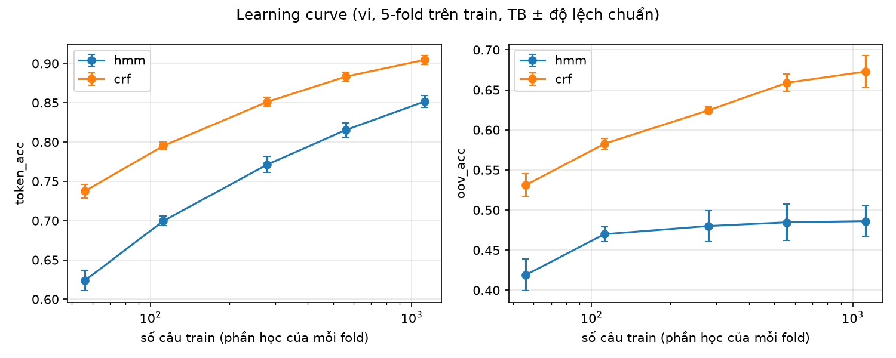
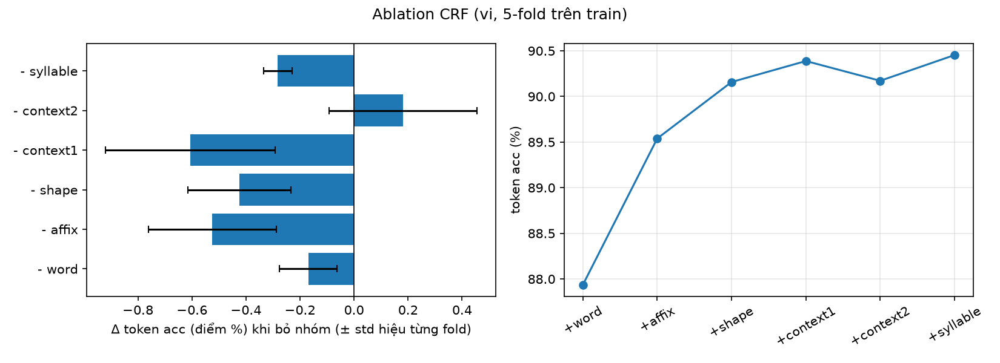
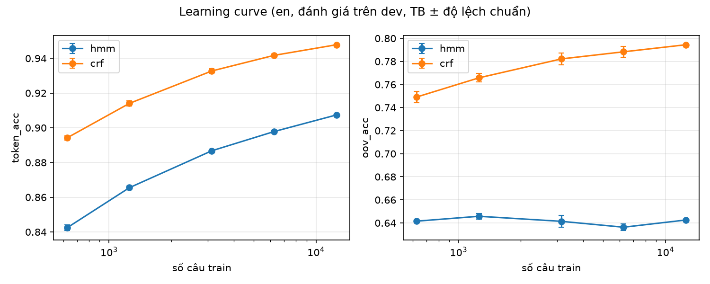
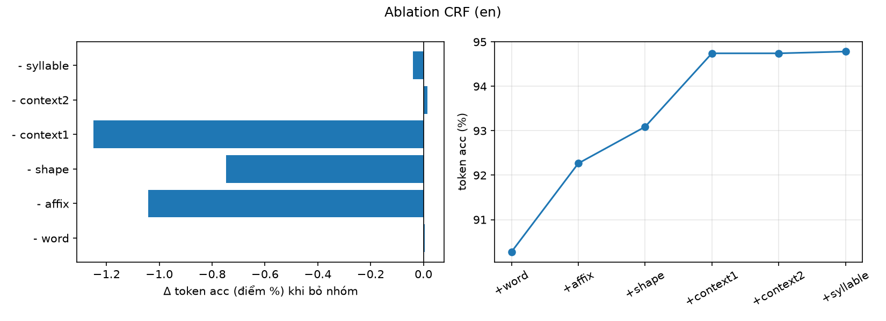

# Generative vs. Discriminative Models for POS Tagging

[](https://github.com/thanhtan2210/pos-tagging-hmm-vs-crf/actions/workflows/tests.yml)

[](LICENSE)

A controlled comparison of a **generative** model (HMM) and **discriminative** models (MaxEnt, MEMM, CRF) for
part-of-speech tagging on **Vietnamese** and **English**, using [Universal Dependencies](https://universaldependencies.org/)
treebanks and the 17-tag UPOS tagset. The HMM and Viterbi decoder are implemented from scratch in NumPy.

Machine Learning course project (CO3117), Ho Chi Minh City University of Technology (HCMUT).
Vietnamese version: [README.vi.md](README.vi.md).

## Contents

- [Highlights](#highlights)
- [Research questions](#research-questions)
- [Data](#data)
- [Methods](#methods)
- [Results](#results)
- [Reproducing the results](#reproducing-the-results)
- [Using the taggers in Python](#using-the-taggers-in-python)
- [Repository layout](#repository-layout)
- [Limitations](#limitations)
- [Authors](#authors)
- [Citation](#citation)
- [License](#license)

## Highlights

Test-set token accuracy (evaluated once, with hyperparameters frozen beforehand):

| Model | Vietnamese | English |
|---|---|---|
| Most-frequent-tag baseline | 82.33% | 86.20% |
| HMM (bigram, signature UNK) | 83.55% | 91.18% |
| MaxEnt (per token) | 87.87% | 94.62% |
| MEMM | 88.06% | 94.72% |
| **CRF** | **88.34%** | **94.92%** |

- **CRF beats HMM by 4–5 points** in both languages, at every training-set size, and under every evaluation protocol.
- The largest gap is on **unseen words**: discriminative models lead the HMM by 15–19 points on OOV tokens.
- **Useful features depend on the language**: affixes matter far more for English; ±1 context matters for both.
- **Feature design matters more than the sequence model**: MaxEnt, MEMM and CRF are within 0.5 points.

## Research questions

| | Question | Experiment |
|---|---|---|
| RQ1 | How does training-set size affect generative vs. discriminative models? (Ng & Jordan, 2002) | Learning curves on 5% → 100% of train |
| RQ2 | Which model handles unseen (OOV) words better, and why? | OOV accuracy; three HMM UNK strategies; error analysis |
| RQ3 | Which features help, and is it language-dependent? | CRF feature-group ablation; genetic algorithm; L1 |
| RQ4 | Does modelling the whole sequence beat per-token classification? | MaxEnt vs. MEMM vs. CRF with identical features |

## Data

| Language | Treebank | Train / dev / test sentences | Train tokens | Dev OOV rate |
|---|---|---|---|---|
| Vietnamese | [UD_Vietnamese-VTB](https://github.com/UniversalDependencies/UD_Vietnamese-VTB) | 1,400 / 1,123 / 800 | 20,215 | 18.5% |
| English | [UD_English-EWT](https://github.com/UniversalDependencies/UD_English-EWT) | 12,544 / 2,001 / 2,077 | 204,578 | 8.3% |

- Data is **not** stored in the repository. `scripts/download_data.py` fetches the CoNLL-U files from the UD `master`
  branch (retrieved 2026-10-24, identical to release r2.19 for these files). Pass `--ref r2.19` to pin a release.
- Preprocessing keeps the FORM and UPOS columns and drops comment lines, multi-word token ranges (`2-3`) and empty
  nodes (`8.1`). Vietnamese multi-syllable words (e.g. "học sinh") stay as single tokens.
- **Known issue:** VTB dev is distributed differently from train and test. Train and test contain only sentences of
  ≤ 25 words, while a third of dev sentences are longer
  ([figure](results/figures/sentence_length.png), [notes](docs/notes/GHI_CHU.md)). For Vietnamese, models are therefore
  compared with 5-fold cross-validation on train; the dev set is used only to study sentence length.

## Methods

| Model | Type | Implementation |
|---|---|---|
| Most-frequent tag | baseline | `src/baseline.py` |
| Bigram HMM + Viterbi, add-α smoothing, 3 UNK strategies (`add-alpha`, `rare`, `signature`) | generative | `src/hmm.py` (from scratch) |
| MaxEnt (multinomial logistic regression per token) | discriminative | `src/memm.py` (scikit-learn) |
| MEMM (previous tag as feature + Viterbi decoding) | discriminative | `src/memm.py` |
| Linear-chain CRF (L-BFGS, L1 + L2) | discriminative | `src/crf.py` (sklearn-crfsuite) |

Feature groups shared by MaxEnt, MEMM and CRF (`src/features.py`): `word`, `affix` (prefixes/suffixes 1–4),
`shape` (case, digits, hyphen, punctuation, position), `context1` (±1 words), `context2` (±2 words),
`syllable` (Vietnamese multi-syllable words).

### Evaluation protocol

- Hyperparameters are chosen by 3-fold cross-validation **on train**, split by sentence (`scripts/tune.py` →
  `configs/best_params.json`). Dev and test are never used for tuning.
- Metrics: token accuracy, OOV accuracy, macro-F1 (the label distribution is highly skewed), sentence accuracy.
- Significance: paired bootstrap resampling by sentence (1,000 samples) and McNemar's test.
- The test set was evaluated **once**. Do not re-run `make final`.

## Results

### Development results

Vietnamese: mean over 5-fold cross-validation on train. English: dev set.
Full tables: [results_cv.md](results/tables/results_cv.md), [results_dev.md](results/tables/results_dev.md).

| Model | vi acc | vi OOV | en acc | en OOV |
|---|---|---|---|---|
| Baseline | 86.07% | 37.96% | 86.13% | 29.56% |
| HMM (add-α, single UNK) | 83.62% | 13.25% | 87.47% | 25.68% |
| HMM (signature UNK, tuned) | 85.15% | 48.61% | 90.74% | 64.25% |
| MaxEnt | 90.37% | 66.14% | 94.41% | 78.97% |
| MEMM | 90.60% | 67.65% | 94.52% | 79.11% |
| CRF | 90.45% | 67.28% | 94.78% | 79.44% |

Vietnamese CV accuracy is higher than dev or test accuracy because sentences from the same article can fall on both
sides of a fold; compare models within a column, not across columns.

### Test results

Full tables: [results_test.md](results/tables/results_test.md), [analysis_vi_test.md](results/tables/analysis_vi_test.md),
[analysis_en_test.md](results/tables/analysis_en_test.md).

| Model | vi acc | vi OOV | vi macro-F1 | en acc | en OOV | en macro-F1 |
|---|---|---|---|---|---|---|
| Baseline | 82.33% | 34.29% | .730 | 86.20% | 30.80% | .792 |
| HMM (signature UNK) | 83.55% | 49.46% | .738 | 91.18% | 64.35% | .855 |
| MaxEnt | 87.87% | 66.46% | .760 | 94.62% | 78.75% | .895 |
| MEMM | 88.06% | 66.40% | .776 | 94.72% | 79.19% | .895 |
| **CRF** | **88.34%** | **67.60%** | **.787** | **94.92%** | **80.32%** | **.902** |

### Findings

| RQ | Hypothesis | Result | Verdict |
|---|---|---|---|
| RQ1 | HMM wins with little data; CRF overtakes later (Ng & Jordan) | CRF wins at every size, even 56 Vietnamese sentences; the gap shrinks from 11.4 to 5.3 points (vi) | **Rejected** (the models use different features) |
| RQ2 | Discriminative models handle OOV better; UNK handling drives HMM quality | CRF leads by 15–19 OOV points; signature UNK classes raise HMM OOV accuracy ~4× (vi) | **Confirmed** |
| RQ3 | Useful features depend on the language | Removing affixes: −1.04 (en) vs. −0.52 (vi); ±2 context never helps (ablation and GA agree) | **Confirmed** |
| RQ4 | CRF beats MEMM and MaxEnt (no label bias) | Within 0.5 points; significant on test and English dev, not in Vietnamese CV | **Partly confirmed** |

One Vietnamese result depends on the protocol: HMM minus baseline is −0.34 on dev (not significant), −0.92 in
5-fold CV and +1.22 on test. We therefore only claim that the Vietnamese HMM is on par with the baseline. Every
other conclusion holds under all three protocols.

| Learning curves (RQ1) | Feature ablation (RQ3) |
|---|---|
|  |  |
|  |  |

All tables and figures are listed in [results/tables/README.md](results/tables/README.md) and
[results/figures/README.md](results/figures/README.md), each with the command that produced it.

## Reproducing the results

### 1. Setup

Python 3.11. About 4 GB of free RAM is needed for MaxEnt/MEMM on English.

```bash
git clone https://github.com/thanhtan2210/pos-tagging-hmm-vs-crf.git
cd pos-tagging-hmm-vs-crf
python -m venv .venv
source .venv/bin/activate          # Windows (cmd): .venv\Scripts\activate.bat
pip install -r requirements.txt
python scripts/download_data.py
python -m pytest -q                # 19 tests, no UD data required
```

### 2. Run everything

```bash
make all
```

`make all` runs the steps below in order. On Windows without `make`, run the commands directly.

| Step | Command | Output | Time* |
|---|---|---|---|
| Data statistics | `python scripts/eda.py` | `results/eda.md`, `figures/sentence_length.png` | seconds |
| Hyperparameter search | `python scripts/tune.py` | `configs/best_params.json`, `tables/tune_*.md` | ~15 min |
| Dev results (all models) | `python scripts/run_experiments.py` | `tables/results_dev.md`, `results/preds/*_dev.jsonl` | ~10 min |
| Vietnamese 5-fold CV | `python scripts/run_experiments.py --split cv --langs vi` | `tables/results_cv.md` | ~3 min |
| Error analysis | `python scripts/analyze.py` and `python scripts/analyze.py --split cv --langs vi` | `tables/analysis_*.md`, confusion matrices | ~2 min |
| RQ1 learning curves | `python scripts/learning_curve.py` | `tables/learning_curve.csv`, figures | ~15 min |
| RQ3 ablation | `python scripts/ablation.py` | `tables/ablation_*.md`, figures | ~20 min |
| Genetic algorithm (optional) | `python -m src.ga --lang vi` | `tables/ga_vi.md`, figure | ~10 min |

\*On a laptop CPU; most of the time is spent training CRF, MaxEnt and MEMM on English.

Useful options: `--models baseline hmm crf` and `--langs vi` restrict a run; `--seed` changes the random seed
(default 42). `analyze.py` only reads saved predictions from `results/preds/`, so run `run_experiments.py`
with the same `--split` first.

### 3. Docker

```bash
docker build -t pos-tagging .
docker run --rm -v "$PWD/results:/app/results" pos-tagging        # runs `make all`
```

### Reproducibility notes

- Every result row stores its hyperparameters and seed.
- Results were reproduced on Windows and inside the Docker image (Linux). Baseline, HMM, MaxEnt and MEMM match
  exactly; CRF can differ in the second decimal place because of floating-point differences between platforms.

## Using the taggers in Python

All taggers share the same interface: `fit(sentences)` with `sentences = [(words, tags), ...]`, and `predict(words)`.

```python
from src.data import load
from src.hmm import HMMTagger
from src.crf import CRFTagger
from src.evaluate import evaluate
from src.data import vocabulary

train, dev = load("en", "train"), load("en", "dev")

hmm = HMMTagger(alpha=0.001, unk="signature").fit(train)
crf = CRFTagger(c1=0.05, c2=0.1).fit(train)           # about 1 minute

print(crf.predict(["I", "want", "to", "book", "a", "flight"]))
print(evaluate(crf, dev, vocabulary(train))["token_acc"])
```

## Repository layout

```
src/                    library code (imported by scripts and tests)
  data.py               CoNLL-U reader
  baseline.py           most-frequent-tag baseline
  hmm.py                bigram HMM, Viterbi, UNK strategies
  features.py           named feature groups for MaxEnt / MEMM / CRF
  crf.py                CRF wrapper (sklearn-crfsuite)
  memm.py               MaxEnt and MEMM
  evaluate.py           predict_all, metrics(mask), save/load predictions
  model_selection.py    sentence-level k-fold, grid search, subsampling
  stats.py              paired bootstrap, McNemar
  ga.py                 genetic algorithm over feature groups
scripts/                one script per experiment (see the table above)
configs/                best_params.json, generated by scripts/tune.py
results/tables/         committed result tables
results/figures/        committed figures
tests/                  pytest suite (runs on toy data)
docs/notes/             project notes and decisions
Makefile, Dockerfile    one-command reproduction
```

## Limitations

- First-order (bigram) HMM only; a trigram HMM with better smoothing could narrow the gap.
- The `signature` UNK strategy makes the HMM forget the tags of words seen once in training (49% vs. 91% for the
  baseline on those words in Vietnamese CV).
- VTB has no document IDs, so folds are split by sentence and Vietnamese CV accuracy is optimistic.
- Small hyperparameter grids (3-fold); MaxEnt and MEMM use default regularization (C = 1).
- No deep-learning baseline (e.g. BiLSTM-CRF, PhoBERT).

## Authors

Nguyễn Văn Nhật Tân, Phan Thanh Tấn, Vương Minh Khôi. Supervisor: Đinh Phúc Hưng.

## Citation

If you use this code, please cite the repository:

```bibtex
@misc{pos-tagging-hmm-vs-crf,
  title  = {Generative vs. Discriminative Models for POS Tagging on Vietnamese and English},
  author = {Nguyễn Văn Nhật Tân and Phan Thanh Tấn and Vương Minh Khôi},
  year   = {2026},
  howpublished = {\url{https://github.com/thanhtan2210/pos-tagging-hmm-vs-crf}}
}
```

Data and methods:

- J. Nivre et al. Universal Dependencies v2: An evergrowing multilingual treebank collection. LREC 2020.
- N. Silveira et al. A gold standard dependency corpus for English. LREC 2014. (UD_English-EWT)
- A. Y. Ng and M. I. Jordan. On discriminative vs. generative classifiers. NIPS 2002.
- J. Lafferty, A. McCallum, F. Pereira. Conditional random fields. ICML 2001.
- A. McCallum, D. Freitag, F. Pereira. Maximum entropy Markov models. ICML 2000.

## License

Code: MIT ([LICENSE](LICENSE)). The UD treebanks are distributed under their own licenses and are not included here.
