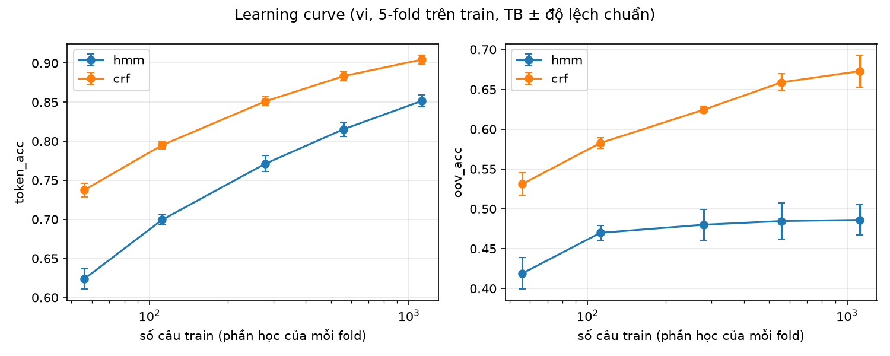
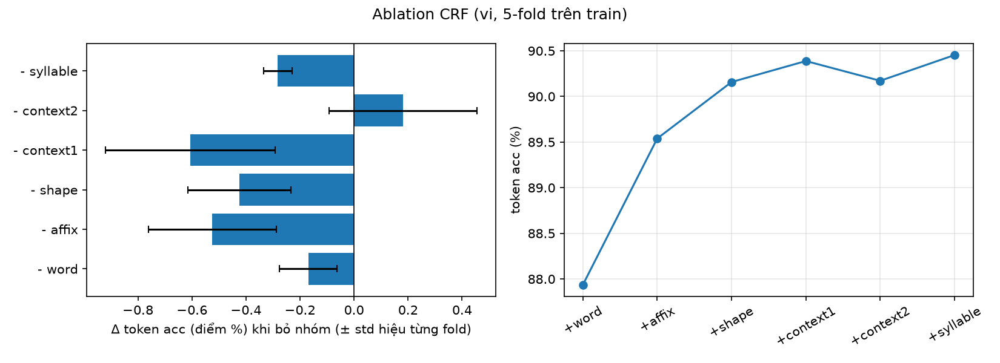
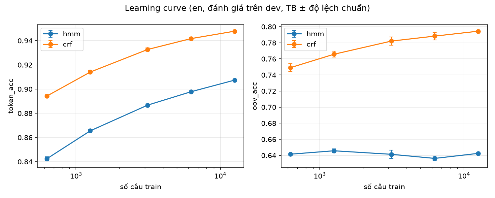
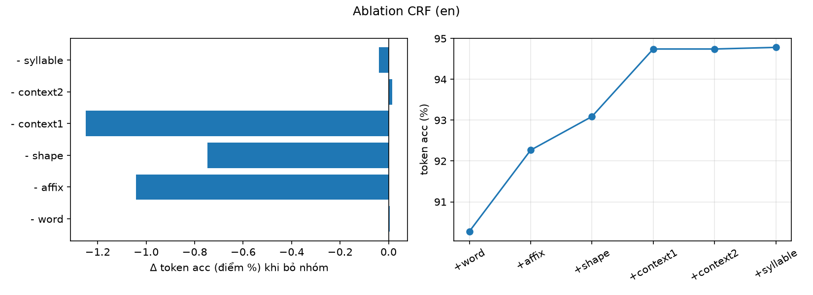

# Mô hình sinh và mô hình phân biệt trong gán nhãn từ loại

[](https://github.com/thanhtan2210/pos-tagging-hmm-vs-crf/actions/workflows/tests.yml)

[](LICENSE)

So sánh có kiểm soát giữa **mô hình sinh** (HMM) và **mô hình phân biệt** (MaxEnt, MEMM, CRF) cho bài toán gán
nhãn từ loại trên **tiếng Việt** và **tiếng Anh**, dùng treebank [Universal Dependencies](https://universaldependencies.org/)
với bộ 17 nhãn UPOS. HMM và thuật toán Viterbi được tự cài đặt bằng NumPy.

Bài tập lớn môn Học máy (CO3117), HK261, Trường ĐH Bách Khoa – ĐHQG-HCM. English: [README.md](README.md).

## Mục lục

- [Điểm nổi bật](#điểm-nổi-bật)
- [Câu hỏi nghiên cứu](#câu-hỏi-nghiên-cứu)
- [Dữ liệu](#dữ-liệu)
- [Phương pháp](#phương-pháp)
- [Kết quả](#kết-quả)
- [Chạy lại kết quả](#chạy-lại-kết-quả)
- [Dùng các mô hình trong Python](#dùng-các-mô-hình-trong-python)
- [Cấu trúc repo](#cấu-trúc-repo)
- [Hạn chế](#hạn-chế)
- [Tác giả](#tác-giả)
- [Trích dẫn](#trích-dẫn)
- [License](#license)

## Điểm nổi bật

Token accuracy trên tập test (đánh giá một lần, tham số đã chốt trước):

| Mô hình | Tiếng Việt | Tiếng Anh |
|---|---|---|
| Baseline nhãn phổ biến nhất | 82.33% | 86.20% |
| HMM (bigram, UNK theo hình thái) | 83.55% | 91.18% |
| MaxEnt (từng từ) | 87.87% | 94.62% |
| MEMM | 88.06% | 94.72% |
| **CRF** | **88.34%** | **94.92%** |

- **CRF hơn HMM 4–5 điểm** ở cả hai ngôn ngữ, ở mọi lượng dữ liệu và trên mọi cách đánh giá.
- Khoảng cách lớn nhất nằm ở **từ chưa gặp**: mô hình phân biệt hơn HMM 15–19 điểm trên token OOV.
- **Đặc trưng hữu ích phụ thuộc ngôn ngữ**: tiền/hậu tố quan trọng với tiếng Anh hơn nhiều; ngữ cảnh ±1 quan trọng với cả hai.
- **Thiết kế đặc trưng quan trọng hơn mô hình chuỗi**: MaxEnt, MEMM và CRF chênh nhau dưới 0.5 điểm.

## Câu hỏi nghiên cứu

| | Câu hỏi | Thí nghiệm |
|---|---|---|
| RQ1 | Lượng dữ liệu huấn luyện ảnh hưởng thế nào đến mô hình sinh và mô hình phân biệt? (Ng & Jordan, 2002) | Learning curve trên 5% → 100% tập train |
| RQ2 | Mô hình nào xử lý từ chưa gặp (OOV) tốt hơn, và vì sao? | Accuracy trên OOV; 3 chiến lược UNK của HMM; phân tích lỗi |
| RQ3 | Đặc trưng nào có ích, có phụ thuộc ngôn ngữ không? | Ablation nhóm đặc trưng CRF; thuật toán di truyền; L1 |
| RQ4 | Mô hình hóa cả chuỗi có hơn phân loại từng từ không? | MaxEnt vs. MEMM vs. CRF với cùng bộ đặc trưng |

## Dữ liệu

| Ngôn ngữ | Treebank | Số câu train / dev / test | Token train | Tỷ lệ OOV trên dev |
|---|---|---|---|---|
| Tiếng Việt | [UD_Vietnamese-VTB](https://github.com/UniversalDependencies/UD_Vietnamese-VTB) | 1.400 / 1.123 / 800 | 20.215 | 18,5% |
| Tiếng Anh | [UD_English-EWT](https://github.com/UniversalDependencies/UD_English-EWT) | 12.544 / 2.001 / 2.077 | 204.578 | 8,3% |

- Dữ liệu **không** nằm trong repo. `scripts/download_data.py` tải file CoNLL-U từ nhánh `master` của UD (ngày 24/10/2026,
  trùng với bản phát hành r2.19 với các file này). Dùng `--ref r2.19` để cố định phiên bản.
- Tiền xử lý: giữ cột FORM và UPOS; bỏ dòng chú thích, token gộp (`2-3`) và nút rỗng (`8.1`). Từ nhiều âm tiết của
  tiếng Việt (vd. "học sinh") được giữ là một token.
- **Lưu ý:** dev của VTB lệch phân phối so với train và test. Train và test chỉ có câu ≤ 25 từ, còn 1/3 số câu dev dài
  hơn ([hình](results/figures/sentence_length.png), [ghi chú](docs/notes/GHI_CHU.md)). Vì vậy, với tiếng Việt, các mô hình
  được so sánh bằng kiểm định chéo 5-fold trên train; dev chỉ dùng để phân tích ảnh hưởng của độ dài câu.

## Phương pháp

| Mô hình | Loại | Cài đặt |
|---|---|---|
| Nhãn phổ biến nhất | baseline | `src/baseline.py` |
| HMM bigram + Viterbi, làm trơn add-α, 3 chiến lược UNK (`add-alpha`, `rare`, `signature`) | mô hình sinh | `src/hmm.py` (tự cài đặt) |
| MaxEnt (hồi quy logistic nhiều lớp cho từng từ) | mô hình phân biệt | `src/memm.py` (scikit-learn) |
| MEMM (nhãn trước làm đặc trưng + giải mã Viterbi) | mô hình phân biệt | `src/memm.py` |
| CRF chuỗi tuyến tính (L-BFGS, phạt L1 + L2) | mô hình phân biệt | `src/crf.py` (sklearn-crfsuite) |

Nhóm đặc trưng dùng chung cho MaxEnt, MEMM và CRF (`src/features.py`): `word`, `affix` (tiền/hậu tố dài 1–4),
`shape` (chữ hoa, chữ số, gạch nối, dấu câu, vị trí), `context1` (từ ±1), `context2` (từ ±2),
`syllable` (từ nhiều âm tiết của tiếng Việt).

### Quy trình đánh giá

- Tham số được chọn bằng kiểm định chéo 3-fold **trên train**, chia theo câu (`scripts/tune.py` →
  `configs/best_params.json`). Dev và test không bao giờ dùng để chọn tham số.
- Độ đo: token accuracy, OOV accuracy, Macro-F1 (vì phân bố nhãn rất lệch), sentence accuracy.
- Kiểm định ý nghĩa: paired bootstrap lấy mẫu theo câu (1.000 lần) và kiểm định McNemar.
- Tập test đã được đánh giá **một lần**. Không chạy lại `make final`.

## Kết quả

### Giai đoạn phát triển

Tiếng Việt: trung bình 5-fold trên train. Tiếng Anh: dev.
Bảng đầy đủ: [results_cv.md](results/tables/results_cv.md), [results_dev.md](results/tables/results_dev.md).

| Mô hình | vi acc | vi OOV | en acc | en OOV |
|---|---|---|---|---|
| Baseline | 86.07% | 37.96% | 86.13% | 29.56% |
| HMM (add-α, một UNK chung) | 83.62% | 13.25% | 87.47% | 25.68% |
| HMM (UNK theo hình thái, đã tune) | 85.15% | 48.61% | 90.74% | 64.25% |
| MaxEnt | 90.37% | 66.14% | 94.41% | 78.97% |
| MEMM | 90.60% | 67.65% | 94.52% | 79.11% |
| CRF | 90.45% | 67.28% | 94.78% | 79.44% |

Accuracy 5-fold tiếng Việt cao hơn dev và test vì các câu của cùng một bài báo có thể nằm ở cả hai phía của một fold;
chỉ nên so sánh các mô hình trong cùng một cột.

### Kết quả trên test

Bảng đầy đủ: [results_test.md](results/tables/results_test.md), [analysis_vi_test.md](results/tables/analysis_vi_test.md),
[analysis_en_test.md](results/tables/analysis_en_test.md).

| Mô hình | vi acc | vi OOV | vi Macro-F1 | en acc | en OOV | en Macro-F1 |
|---|---|---|---|---|---|---|
| Baseline | 82.33% | 34.29% | .730 | 86.20% | 30.80% | .792 |
| HMM (UNK theo hình thái) | 83.55% | 49.46% | .738 | 91.18% | 64.35% | .855 |
| MaxEnt | 87.87% | 66.46% | .760 | 94.62% | 78.75% | .895 |
| MEMM | 88.06% | 66.40% | .776 | 94.72% | 79.19% | .895 |
| **CRF** | **88.34%** | **67.60%** | **.787** | **94.92%** | **80.32%** | **.902** |

### Phát hiện chính

| RQ | Giả thuyết | Kết quả | Kết luận |
|---|---|---|---|
| RQ1 | Ít dữ liệu thì HMM thắng; CRF vượt lên khi dữ liệu nhiều (Ng & Jordan) | CRF thắng ở mọi mức, kể cả 56 câu tiếng Việt; khoảng cách giảm từ 11.4 xuống 5.3 điểm (vi) | **Bác bỏ** (hai mô hình dùng đặc trưng khác nhau) |
| RQ2 | Mô hình phân biệt xử lý từ lạ tốt hơn; cách xử lý UNK quyết định HMM | CRF hơn 15–19 điểm trên OOV; UNK theo hình thái tăng OOV accuracy của HMM gần 4 lần (vi) | **Xác nhận** |
| RQ3 | Đặc trưng hữu ích phụ thuộc ngôn ngữ | Bỏ tiền/hậu tố: −1.04 (en) so với −0.52 (vi); ngữ cảnh ±2 không giúp (ablation và GA cùng kết luận) | **Xác nhận** |
| RQ4 | CRF hơn MEMM và MaxEnt (không bị label bias) | Chênh dưới 0.5 điểm; có ý nghĩa trên test và dev tiếng Anh, không có ý nghĩa trên 5-fold tiếng Việt | **Xác nhận một phần** |

Một kết quả tiếng Việt phụ thuộc vào cách đánh giá: HMM trừ baseline là −0.34 trên dev (không có ý nghĩa), −0.92 trên
5-fold và +1.22 trên test. Vì vậy chỉ kết luận HMM tiếng Việt ngang ngửa baseline. Mọi kết luận khác đều đúng trên cả
ba cách đánh giá.

| Learning curve (RQ1) | Ablation đặc trưng (RQ3) |
|---|---|
|  |  |
|  |  |

Danh sách mọi bảng và hình, kèm lệnh tạo ra chúng: [results/tables/README.md](results/tables/README.md),
[results/figures/README.md](results/figures/README.md).

## Chạy lại kết quả

### 1. Cài đặt

Python 3.11. Cần khoảng 4 GB RAM trống cho MaxEnt/MEMM tiếng Anh.

```bash
git clone https://github.com/thanhtan2210/pos-tagging-hmm-vs-crf.git
cd pos-tagging-hmm-vs-crf
python -m venv .venv
source .venv/bin/activate          # Windows (cmd): .venv\Scripts\activate.bat
pip install -r requirements.txt
python scripts/download_data.py
python -m pytest -q                # 19 test, không cần dữ liệu UD
```

### 2. Chạy toàn bộ

```bash
make all
```

`make all` chạy lần lượt các bước dưới đây. Trên Windows không có `make`, chạy trực tiếp từng lệnh.

| Bước | Lệnh | Đầu ra | Thời gian* |
|---|---|---|---|
| Thống kê dữ liệu | `python scripts/eda.py` | `results/eda.md`, `figures/sentence_length.png` | vài giây |
| Chọn tham số | `python scripts/tune.py` | `configs/best_params.json`, `tables/tune_*.md` | ~15 phút |
| Kết quả dev (mọi mô hình) | `python scripts/run_experiments.py` | `tables/results_dev.md`, `results/preds/*_dev.jsonl` | ~10 phút |
| 5-fold tiếng Việt | `python scripts/run_experiments.py --split cv --langs vi` | `tables/results_cv.md` | ~3 phút |
| Phân tích lỗi | `python scripts/analyze.py` và `python scripts/analyze.py --split cv --langs vi` | `tables/analysis_*.md`, ma trận nhầm lẫn | ~2 phút |
| RQ1 learning curve | `python scripts/learning_curve.py` | `tables/learning_curve.csv`, hình | ~15 phút |
| RQ3 ablation | `python scripts/ablation.py` | `tables/ablation_*.md`, hình | ~20 phút |
| Thuật toán di truyền (tùy chọn) | `python -m src.ga --lang vi` | `tables/ga_vi.md`, hình | ~10 phút |

\*Trên CPU laptop; phần lớn thời gian là huấn luyện CRF, MaxEnt và MEMM tiếng Anh.

Tùy chọn hữu ích: `--models baseline hmm crf` và `--langs vi` để giới hạn lần chạy; `--seed` đổi seed (mặc định 42).
`analyze.py` chỉ đọc dự đoán đã lưu trong `results/preds/`, nên cần chạy `run_experiments.py` với cùng `--split` trước.

### 3. Docker

```bash
docker build -t pos-tagging .
docker run --rm -v "$PWD/results:/app/results" pos-tagging        # chạy `make all`
```

### Ghi chú về tái lập

- Mỗi dòng kết quả đều lưu kèm tham số và seed.
- Kết quả đã được chạy lại trên Windows và trong Docker (Linux). Baseline, HMM, MaxEnt và MEMM trùng khớp hoàn toàn;
  CRF có thể lệch ở chữ số thập phân thứ hai do sai số dấu phẩy động giữa các nền tảng.

## Dùng các mô hình trong Python

Mọi mô hình có cùng giao diện: `fit(sentences)` với `sentences = [(words, tags), ...]`, và `predict(words)`.

```python
from src.data import load
from src.hmm import HMMTagger
from src.crf import CRFTagger
from src.evaluate import evaluate
from src.data import vocabulary

train, dev = load("en", "train"), load("en", "dev")

hmm = HMMTagger(alpha=0.001, unk="signature").fit(train)
crf = CRFTagger(c1=0.05, c2=0.1).fit(train)           # khoảng 1 phút

print(crf.predict(["I", "want", "to", "book", "a", "flight"]))
print(evaluate(crf, dev, vocabulary(train))["token_acc"])
```

## Cấu trúc repo

```
src/                    thư viện (được scripts và tests import)
  data.py               đọc CoNLL-U
  baseline.py           baseline nhãn phổ biến nhất
  hmm.py                HMM bigram, Viterbi, chiến lược UNK
  features.py           nhóm đặc trưng có tên cho MaxEnt / MEMM / CRF
  crf.py                CRF (sklearn-crfsuite)
  memm.py               MaxEnt và MEMM
  evaluate.py           predict_all, metrics(mask), lưu/đọc dự đoán
  model_selection.py    k-fold theo câu, grid search, lấy tập con
  stats.py              paired bootstrap, McNemar
  ga.py                 thuật toán di truyền chọn nhóm đặc trưng
scripts/                mỗi thí nghiệm một script (xem bảng ở trên)
configs/                best_params.json, sinh bởi scripts/tune.py
results/tables/         bảng kết quả (được commit)
results/figures/        hình (được commit)
tests/                  pytest (chạy trên dữ liệu đồ chơi)
docs/notes/             ghi chú và các quyết định trong dự án
Makefile, Dockerfile    chạy lại bằng một lệnh
```

## Hạn chế

- Chỉ dùng HMM bậc một (bigram); HMM trigram với làm trơn tốt hơn có thể thu hẹp khoảng cách.
- Chiến lược UNK `signature` làm HMM "quên" nhãn của các từ chỉ gặp một lần trong train (49% so với 91% của baseline
  trên nhóm từ này, 5-fold tiếng Việt).
- VTB không có mã văn bản nên fold được chia theo câu, khiến accuracy 5-fold tiếng Việt lạc quan.
- Lưới tham số nhỏ (3-fold); MaxEnt và MEMM dùng điều chuẩn mặc định (C = 1).
- Chưa có mốc so sánh học sâu (BiLSTM-CRF, PhoBERT).

## Tác giả

Nguyễn Văn Nhật Tân, Phan Thanh Tấn, Vương Minh Khôi. Giảng viên hướng dẫn: Đinh Phúc Hưng.

## Trích dẫn

Nếu dùng mã nguồn này, vui lòng trích dẫn repo:

```bibtex
@misc{pos-tagging-hmm-vs-crf,
  title  = {Generative vs. Discriminative Models for POS Tagging on Vietnamese and English},
  author = {Nguyễn Văn Nhật Tân and Phan Thanh Tấn and Vương Minh Khôi},
  year   = {2026},
  howpublished = {\url{https://github.com/thanhtan2210/pos-tagging-hmm-vs-crf}}
}
```

Dữ liệu và phương pháp:

- J. Nivre et al. Universal Dependencies v2: An evergrowing multilingual treebank collection. LREC 2020.
- N. Silveira et al. A gold standard dependency corpus for English. LREC 2014. (UD_English-EWT)
- A. Y. Ng and M. I. Jordan. On discriminative vs. generative classifiers. NIPS 2002.
- J. Lafferty, A. McCallum, F. Pereira. Conditional random fields. ICML 2001.
- A. McCallum, D. Freitag, F. Pereira. Maximum entropy Markov models. ICML 2000.

## License

Mã nguồn: MIT ([LICENSE](LICENSE)). Các treebank UD có license riêng và không nằm trong repo này.
